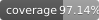

# Datathon – Case Passos Mágicos (PEDE) – MLOps Project

[](https://github.com/mariannave/project-datathon-fiap/actions/workflows/ci.yml)
[](https://github.com/mariannave/project-datathon-fiap/blob/main/docs/coverage.svg)

Projeto de Machine Learning para estimar risco de defasagem escolar usando dados PEDE (2022, 2023 e 2024), com pipeline de treino, API de predição, monitoramento de drift e empacotamento Docker.

Documentação técnica completa (para entrega acadêmica):
- `docs/projeto_modelo_api.md`

## O que este repositório entrega

- Treino completo (`src.train`) com geração de artefatos.
- Modelo serializado em `artifacts/model.joblib`.
- API FastAPI (`POST /predict`).
- Logging de inferências em `data/processed/inference_log.csv`.
- Relatório de drift (PSI) em HTML.
- Testes unitários com `pytest`.

## Stack

- Python 3.11+
- pandas, numpy, scikit-learn
- FastAPI + Uvicorn
- pytest
- joblib
- matplotlib

## Quickstart

1. Criar e ativar ambiente virtual:
```bash
python -m venv .venv
source .venv/bin/activate
```

2. Instalar dependências:
```bash
pip install -r requirements.txt
```

3. Garantir que o arquivo do Datathon esteja em:
```text
data/raw/BASE_DE_DADOS_PEDE_2024_DATATHON.xlsx
```

4. Treinar modelo:
```bash
python -m src.train --excel data/raw/BASE_DE_DADOS_PEDE_2024_DATATHON.xlsx --out artifacts
```

## Rodar API

```bash
.venv/bin/python -m uvicorn api.main:app --host 0.0.0.0 --port 8000
```

Política de decisão conservadora (default):
- `RISK_THRESHOLD=0.8`
- `REVIEW_THRESHOLD=0.5`

Exemplo com configuração explícita:
```bash
RISK_THRESHOLD=0.8 REVIEW_THRESHOLD=0.5 .venv/bin/python -m uvicorn api.main:app --host 0.0.0.0 --port 8000
```

### Exemplo de request

```bash
curl -X POST "http://localhost:8000/predict" \
  -H "Content-Type: application/json" \
  -d '{
    "year": 2023,
    "RA": 12345,
    "Fase": "5",
    "Turma": "5A",
    "Idade": 14,
    "Genero": "M",
    "Ano_ingresso": 2021,
    "Instituicao_de_ensino": "Escola X",
    "IAA": 7.2,
    "IEG": 6.5,
    "IPS": 8.1,
    "IPP": 7.0,
    "IDA": 6.9,
    "IPV": 7.4,
    "IAN": -1,
    "INDE": 6.8,
    "Pedra_atual": "Ametista",
    "Pedra_anterior": "Ágata"
  }'
```

### Exemplo de response

```json
{
  "risk_label": 0,
  "risk_probability": 0.0316,
  "risk_band": "low_risk",
  "risk_threshold": 0.8,
  "review_threshold": 0.5
}
```

## Drift

Pré-requisitos:

1. Modelo treinado (gera `artifacts/reference_stats.json`).
2. API executada com pelo menos algumas inferências salvas em `data/processed/inference_log.csv`.

Gerar relatório de drift com inferências acumuladas:

```bash
.venv/bin/python -m src.drift_cli --reference artifacts/reference_stats.json --inference data/processed/inference_log.csv --out reports/drift_report.html
```

## Testes

```bash
pytest -q
```

### Cobertura de testes

Critério mínimo de aprovação: **80%** de cobertura (`src` + `api`).

Resumo no terminal (falha automaticamente se cobertura < 80%):
```bash
.venv/bin/python -m coverage erase
.venv/bin/python -m coverage run -m pytest -q
.venv/bin/python -m coverage report -m
```

Relatório HTML (abrir `htmlcov/index.html` no navegador):
```bash
.venv/bin/python -m coverage html
```

## Docker

Build:
```bash
docker build -t pede-mlops .
```

Run:
```bash
docker run -p 8000:8000 pede-mlops
```
